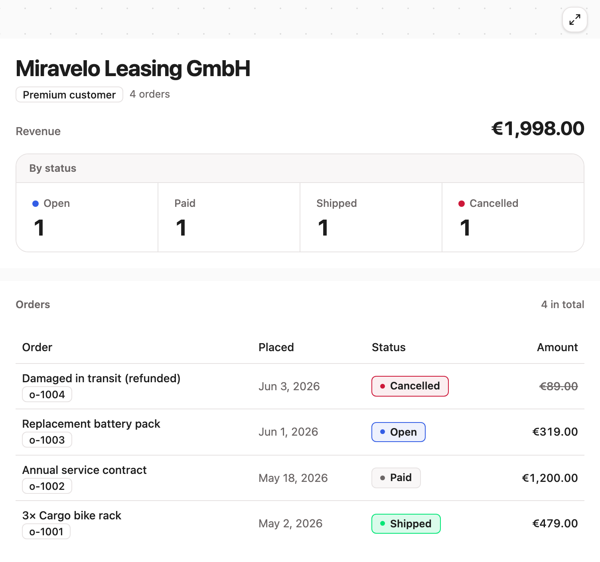

## One tool call, one rendered view

The playground's `show_orders_dashboard` returns a composed view: a KPI strip
above an orders table, both widgets fed by one tool result. Call it yourself in
the [guided tour](./playground/tour.md), no clone needed.

## What the toolkit gives you

- [Plugin contract](./concepts/app-plugins.md): bundle tools, steps and
  widgets into one `AppPlugin`; the framework wires the registries and the
  view rendering.
- [Pipelines and steps](./concepts/pipelines-and-steps.md): resolve data
  declaratively. Steps publish keys, later steps and widgets consume them, and
  a failing step degrades its own cells instead of the whole view.
- [Widgets and the view builder](./concepts/view-builder.md): render
  structured data with React components in the Miragon design system, and
  white-label them through role tokens. Users can edit a view and save it as a
  dashboard without a round trip through the model.
- [Self-contained servers](./concepts/architecture.md): each server owns
  its tools, steps, widgets and UI bundle. Aggregating several servers is the
  job of an MCP gateway in front of them.
- [Middleware](./concepts/middleware.md): org gate and role filter ship as
  composable helpers that pass through when their config is empty.
- [Type-safe tooling](./reference/api-tool-codegen.md): `tool-codegen`
  turns a server's `tools/list` into typed TypeScript and React Query hooks,
  so a renamed tool or a drifted schema fails the build.

The source, the examples and the starter template are on
[GitHub](https://github.com/Miragon/mcp-toolkit).
